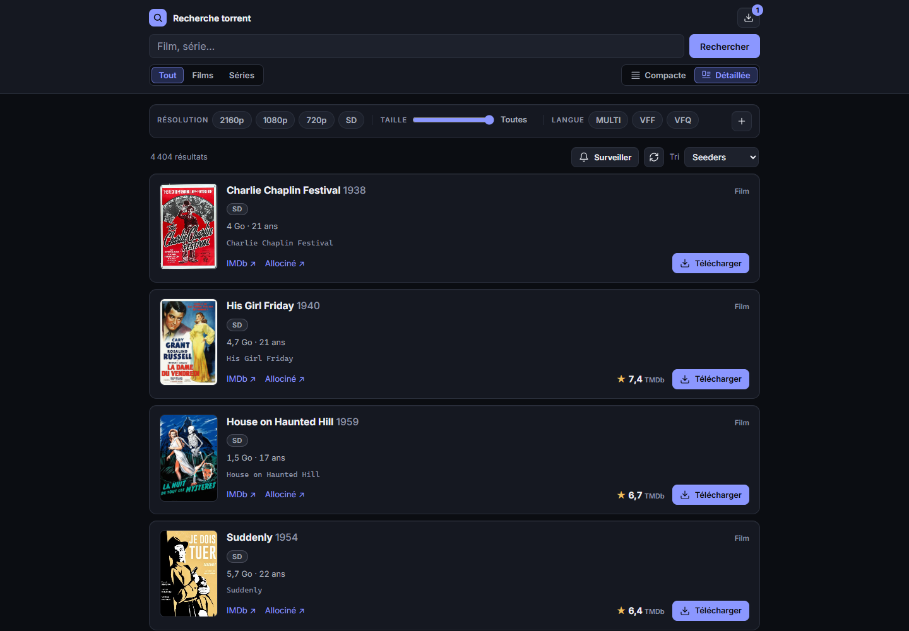
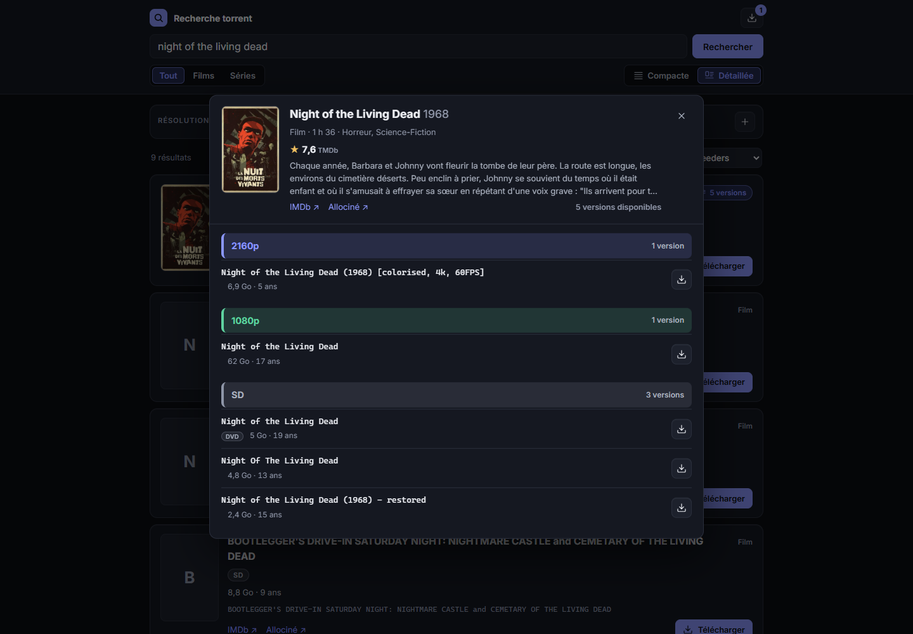
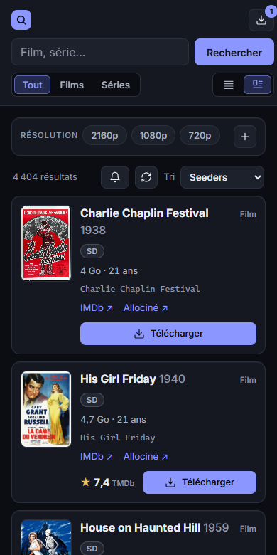

# torrent-console

**A self-hosted search page for torrents, wired to your own Transmission.**

One page on your local network to search torrent sources, with real filters and sorting, posters and ratings from TMDb, and a button that sends a release straight to Transmission. A side panel follows and controls the downloads, and saved searches can notify your phone when something new shows up.

It's small on purpose: a Python server that uses the standard library only (nothing to `pip install`) and a front end in native JavaScript modules, with no build step. It ships with one source, Internet Archive's public-domain films and TV shows, and you can add your own.

The interface is in French, and so are the code comments.



<p>
  
  
</p>

Every screenshot shows public-domain films from Internet Archive.

## Use it responsibly

This project is a search interface and a remote control for a BitTorrent client that you run. It hosts no content and ships no index of copyrighted works: the only source included lists Internet Archive items marked as public domain.

BitTorrent itself is legal, but downloading or sharing a work without the rights holders' permission is not, in most countries. Keep in mind that a BitTorrent client uploads what it downloads: sending a torrent to Transmission means sharing it with others. You are responsible for the sources you add, what you download and following the law where you live. In France, that's the Code de la propriété intellectuelle, and Arcom watches peer-to-peer networks.

The "public domain" mark on Internet Archive is set by whoever uploaded the item. Check the status of a work in your own country before you download it.

The software comes with no warranty, see `LICENSE`.

## What it does

- **Search with filters**: films or TV shows, language tags (MULTI, VFF, VFQ, VOSTFR…), resolution, source (WEB-DL, BluRay, Remux…) and a maximum size. Sort by seeders, newest, or size.
- **Two views**: a compact list, or cards with the poster, TMDb rating and links to IMDb and AlloCiné. The cards group the versions of a title: one card shows the latest version, with a "N versions" badge.
- **All the versions of a title**: click a card to open a window with a short sheet about the title (poster, rating, genres, runtime, start of the summary) and every version the source has, grouped by resolution, biggest first. When the source can tell, each version shows its video bitrate, loaded one by one.
- **Send to Transmission** in one click.
- **Transmission panel**: progress, speeds and time left, pause, resume, remove with or without the files.
- **Watches**: save a search and get a notification when a new release matches it. It never downloads anything on its own.
- **Phone notifications** through a Home Assistant webhook, when a download finishes or a watch finds something. Optional.
- **Account stats** (uploaded, downloaded, ratio) at the top of the page, for sources that provide them.
- **Password**, optional.

## How it works

```
browser ──> app/server.py ──> providers ───────> search, .torrent files
                 │       ├──> TMDb ────────────> posters, ratings, summaries
                 │       ├──> Transmission RPC ─> add, list, pause, remove
                 │       └──> Home Assistant ───> notifications (webhook)
                 ├── config.json   keys and settings, read only
                 └── data/         watches.json, bitrates.json
```

The page asks for results 30 at a time. The source applies the filters it supports itself and sorts the whole catalog. The server applies the others (often size and source), reading a few more pages to fill the batch, up to 5 per batch. Pages already read are kept for 10 minutes, so changing a local filter costs nothing.

Two background tasks run in the server: one checks Transmission every minute for finished downloads, the other runs the watches every 30 minutes (`watches.interval_minutes`).

## Requirements

- **Docker with Compose**, or **Python 3.12 or later**. No other package.
- **Transmission** with remote access (RPC) turned on and reachable from the app: that's where the torrents go, and what the side panel shows. It can run on the same machine or another one on your network. The app never downloads anything itself.
- **A TMDb API Read Access Token**, free with a TMDb account. Without it, there are no posters, ratings or summaries, and everything else works.
- **Home Assistant** with the mobile app, for notifications. Optional.
- **A source**. Internet Archive is built in and needs no account.

## Installation

```sh
git clone https://github.com/BriKKou/torrent-console.git /opt/torrent-console
cd /opt/torrent-console
cp config.example.json config.json
mkdir -p data
chown 1000:1000 config.json data
chmod 600 config.json
nano config.json            # see Configuration below
docker compose up -d
```

Then open `http://<server>:8282/`.

The container runs as UID 1000, which must be able to read `config.json` and write to `data/`. If your user has another UID, change `user:` in `docker-compose.yml` and the `chown` above to match.

Without Docker, set `"data_dir": "data"` in `config.json`, then:

```sh
CONFIG_PATH=config.json python3 app/server.py
```

After changing `config.json` or the code, restart: `docker compose restart`.

## Configuration

Everything lives in `config.json`. Start from `config.example.json`.

| Key | What it is |
|---|---|
| `providers` | The sources to enable, in order, with their options: `{"<key>": {...}}`. The first one is selected when the page opens; with several, a menu appears next to the sort. Built in: `internet_archive`, with no options. |
| `tmdb.token` | TMDb API Read Access Token (the long one, not the API key). Empty: no posters, ratings or summaries. |
| `transmission.url` | Transmission RPC address, usually `http://<host>:9091/transmission/rpc`. |
| `transmission.user`, `transmission.password` | RPC login. Leave both empty if RPC authentication is off. |
| `notifications.webhook_url` | Home Assistant webhook address. Empty: no notifications. |
| `watches.interval_minutes` | Pause between two checks of the watches, in minutes: 30 by default, 5 at least so as not to overload the source. |
| `auth.user`, `auth.password_hash` | Page login. Empty hash: no password. Set them with `set_password.py`. |
| `public_url` | Address of the page, opened when you tap a notification (on the watched search, for a watch). |
| `data_dir` | Where watches and the bitrate cache are written. `/data` in the container. |

### Password

```sh
python3 app/set_password.py config.json
docker compose restart
```

It asks for a login and a password, and stores a PBKDF2-SHA256 hash (200,000 iterations), never the password itself. It runs with the Python 3 of the host, and needs to be able to write `config.json` (run it as its owner, or with `sudo`: owner and permissions are kept).

### Transmission

In Transmission's settings (`settings.json`, or the variables of your Docker image):

- `rpc-enabled`: `true`;
- `rpc-authentication-required`, `rpc-username`, `rpc-password`: the login you put in `config.json`;
- `rpc-whitelist`: must allow the address the app connects from. With Docker, that's often the IP of the Docker bridge, not of the host. If Transmission answers 403, this is the setting to look at.

Files land in Transmission's own download folder: the app adds torrents and controls them, nothing else.

### Home Assistant notifications

Create an automation started by a webhook, which forwards the notification to your phone. Pick a long random webhook ID: whoever knows it can send notifications to your phone.

```yaml
alias: Torrent console - notifications
triggers:
  - trigger: webhook
    webhook_id: torrent-console-<long random id>
    allowed_methods: [POST]
    local_only: true
actions:
  - action: notify.mobile_app_<your_phone>
    data:
      title: "{{ trigger.json.title }}"
      message: "{{ trigger.json.message }}"
      data:
        clickAction: "{{ trigger.json.url }}"   # Android
        url: "{{ trigger.json.url }}"           # iOS
mode: queued
```

Then set `notifications.webhook_url` to `http://<home-assistant>:8123/api/webhook/<the same id>`. The app posts `{"title", "message", "url"}`. For a watch, `url` opens the page on the watched search, sorted by date (`<public_url>?provider=…&q=…&sort=date`); for a finished download, it is your `public_url`. If Home Assistant can't be reached, the notification is dropped and the error logged; nothing else stops.

## Sources

### Internet Archive (built in)

Films from the `feature_films` collection and TV shows from `classic_tv`, only the items marked as public domain, and not the unsorted uploads. archive.org serves the files itself, so there is no seeder count, and sorting by "Seeders" uses the number of downloads instead. Its items rarely carry language tags, so the language filter mostly empties the list.

### Adding a source

A source is a Python module named after its key, with a subclass of `Provider` whose `key` is that same name. Put it in `plugins/` (ignored by git, so site-specific code stays on your machine) or in `app/providers/`, then enable it in `config.json`. The options under its key are passed to its constructor.

```python
# plugins/example.py
from models import ProviderPage, Query, Release
from providers.base import Provider
from releases import describe


class Example(Provider):
    key = "example"                                # module name, and key in config.json
    label = "Example"                              # shown in the page
    native_filters = frozenset({"text", "kind"})   # filters the site applies itself

    def __init__(self, api_key: str):              # "providers": {"example": {"api_key": "..."}}
        self._api_key = api_key

    def search(self, query: Query, page: int) -> ProviderPage:
        """Page `page` (from 1), sorted by query.sort and filtered by native_filters."""

    def download(self, release_id: str) -> bytes:
        """The .torrent file, or a magnet link (b"magnet:?...")."""
```

- `native_filters` lists the `Query` fields the site handles: `text`, `kind`, `langs`, `resolutions`, `sources`, `max_gb`. The others are applied by the server, which reads extra pages to fill each batch.
- `search` must return results already sorted by `query.sort` (`seeders`, `date`, `size_desc`, `size_asc`) over the whole catalog, or pagination won't make sense.
- `releases.describe(name)` reads a scene-style release name (`Film.2024.MULTI.VFF.2160p.WEB-DL.DV.H265-GRP`) and gives the year, season, resolution, language tags, source, HDR and codec, to fill a `Release`. `name` is the readable title: it is used for TMDb and to group the versions of a title. Set `seeders` to `None` if the site doesn't give it.
- `httpclient.get_json` retries on temporary errors and turns a 429 into a clear "slow down" message; `Throttle` spaces calls to the same site.
- Two optional methods. `account()` returns an `Account` (uploaded, downloaded) shown at the top of the page. `video_bitrate(release_id)` returns the video bitrate in kb/s, or `None`; answers are cached in `data/bitrates.json` (5,000 entries, least recently used dropped first). The page only shows these for sources that implement them.

Raise `errors.RemoteError` with a readable message when the site answers something unexpected: it is shown in the page as is.

## Security

- Keep it on your local network. The app has no TLS. To reach it from outside, go through a VPN, or a reverse proxy with HTTPS and its own authentication.
- Set a password. Without one, anyone on your network who opens the page can add torrents to your Transmission and delete your downloads.
- Secrets only live in `config.json`: source keys, TMDb token, Transmission password, webhook address. Keep it `chmod 600`. It's in `.gitignore`, along with `data/` and `plugins/`.
- The POST endpoints only accept `Content-Type: application/json`, which a page on another site can't send without a CORS preflight, and the app doesn't answer preflights. The page builds its DOM without `innerHTML`: everything that comes from a source is inserted as text.
- The app only talks to the sources you enabled, TMDb, Transmission and Home Assistant. The browser loads posters from `image.tmdb.org`, with no referrer.

## Troubleshooting

**"Transmission injoignable" or "erreur HTTP 401/403".** Check `transmission.url`, the RPC login, and `rpc-whitelist` (see [Transmission](#transmission)). From the server, `curl -u user:password http://<host>:9091/transmission/rpc` should answer 409: that's the normal first reply.

**"limite le nombre de requêtes".** The source answered 429. Wait a minute; the results already loaded stay on screen.

**"Réponse inattendue de …".** The source's API has probably changed. The details are in `docker compose logs`.

**No posters.** `tmdb.token` is empty or wrong: it must be the API Read Access Token.

**The app doesn't start and the logs say "Source … introuvable".** A key under `providers` has no matching module in `app/providers/` or `plugins/`.

## Tests

```sh
PYTHONPATH=app python3 -m unittest discover -s tests
```

They need no network and no configuration.

## Repository layout

```
app/server.py          HTTP routes and static files, password, background tasks
app/search.py          batches of 30, filters the source can't apply, 10-minute cache, versions of a title
app/models.py          Query, Release, Account, Batch
app/releases.py        reading release names
app/metadata.py        TMDb: poster, rating, summary, genres, runtime, IMDb id
app/transmission.py    Transmission RPC client
app/watches.py         watches (data/watches.json)
app/bitrates.py        video bitrate cache (data/bitrates.json)
app/background.py      periodic tasks, download-finished notifications
app/notifier.py        Home Assistant webhook
app/auth.py            HTTP Basic authentication, PBKDF2
app/set_password.py    sets the page login
app/httpclient.py      outgoing HTTP calls, retries, spacing
app/storage.py         JSON files written atomically
app/providers/         the Provider contract, the loader, Internet Archive
app/static/            index.html, app.css, js/
plugins/               your own sources, not versioned
tests/
screenshots/           the images in this README
```

The French version of this file is `README_FR.md`.

## License

MIT, see `LICENSE`.
