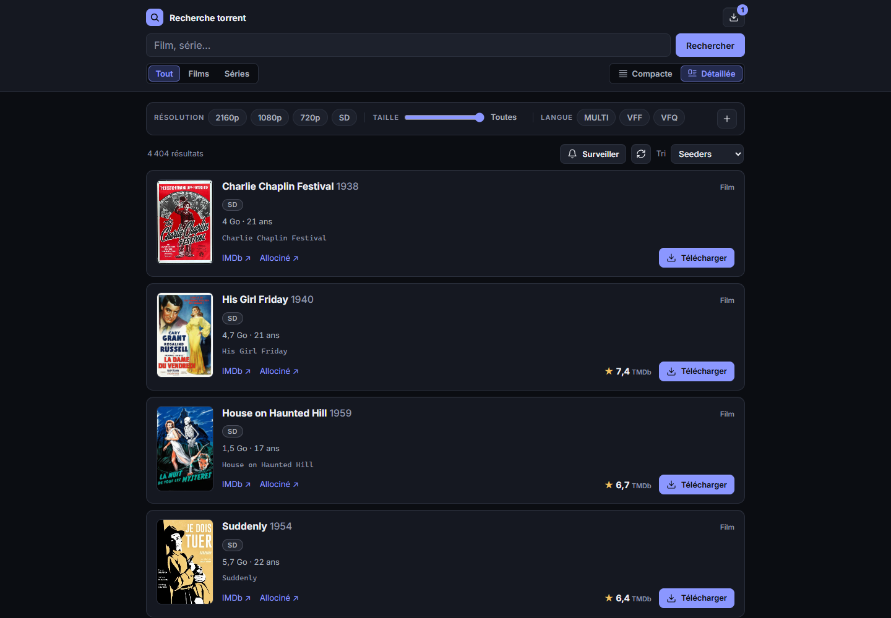
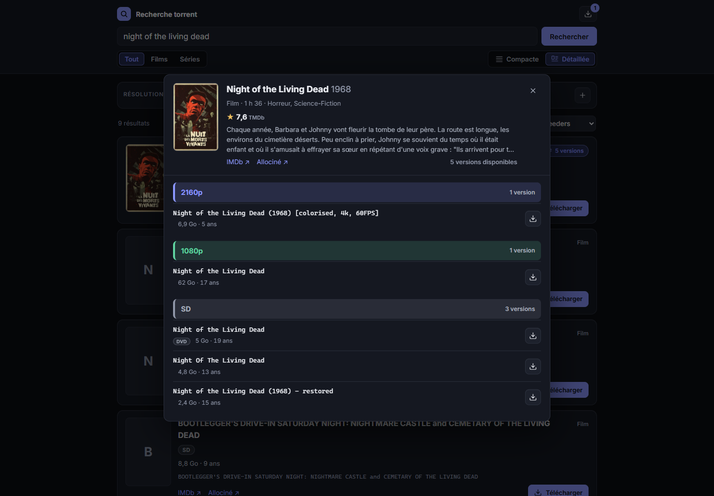
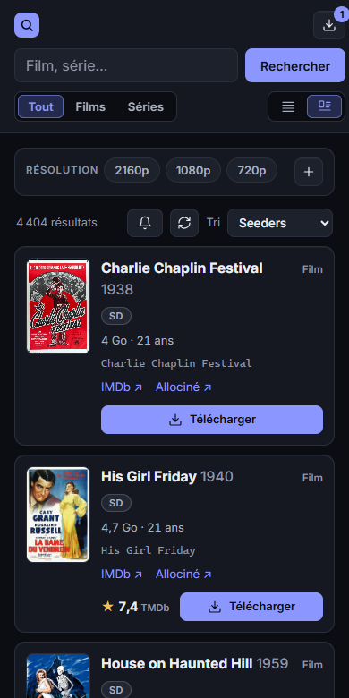

# torrent-console

**Une page de recherche de torrents auto-hébergée, reliée à votre propre Transmission.**

Une page sur votre réseau local pour chercher dans des sources de torrents, avec de vrais filtres et tris, les affiches et notes de TMDb, et un bouton qui envoie une release directement à Transmission. Un volet latéral suit et pilote les téléchargements, et des recherches enregistrées peuvent prévenir votre téléphone quand une nouveauté apparaît.

C'est volontairement petit : un serveur Python qui n'utilise que la bibliothèque standard (rien à installer avec `pip`) et une interface en modules JavaScript natifs, sans étape de build. Le projet est livré avec une seule source, les films et séries du domaine public d'Internet Archive, et vous pouvez ajouter les vôtres.

L'interface est en français, les commentaires du code aussi.



<p>
  
  
</p>

Toutes les captures montrent des films du domaine public, issus d'Internet Archive.

## Utilisation responsable

Ce projet est une interface de recherche et une télécommande pour un client BitTorrent que vous faites tourner. Il n'héberge aucun contenu et ne fournit aucun index d'œuvres protégées : la seule source incluse liste les éléments d'Internet Archive marqués comme relevant du domaine public.

BitTorrent est une technologie légale, mais télécharger ou partager une œuvre sans l'autorisation des ayants droit ne l'est pas, dans la plupart des pays. Gardez en tête qu'un client BitTorrent envoie ce qu'il télécharge : envoyer un torrent à Transmission, c'est le partager. Vous êtes responsable des sources que vous ajoutez, de ce que vous téléchargez et du respect de la loi là où vous vivez. En France, c'est le Code de la propriété intellectuelle, et l'Arcom surveille les réseaux pair-à-pair.

La mention « domaine public » sur Internet Archive est posée par la personne qui a déposé l'élément. Vérifiez le statut d'une œuvre dans votre pays avant de la télécharger.

Le logiciel est fourni sans garantie, voir `LICENSE`.

## Ce qu'il fait

- **Recherche avec filtres** : films ou séries, étiquettes de langue (MULTI, VFF, VFQ, VOSTFR…), résolution, source (WEB-DL, BluRay, Remux…) et taille maximale. Tri par seeders, plus récents ou taille.
- **Deux vues** : une liste compacte, ou des cartes avec l'affiche, la note TMDb et des liens vers IMDb et Allociné. Les cartes regroupent les versions d'un titre : une carte montre la version la plus récente, avec un badge « N versions ».
- **Toutes les versions d'un titre** : un clic sur une carte ouvre une fenêtre avec une courte fiche du titre (affiche, note, genres, durée, début du résumé) et toutes les versions dont dispose la source, regroupées par résolution, de la plus grosse à la plus petite. Quand la source sait le dire, chaque version affiche son débit vidéo, chargé au fur et à mesure.
- **Envoi à Transmission** en un clic.
- **Volet Transmission** : progression, vitesses et temps restant, pause, reprise, suppression avec ou sans les fichiers.
- **Surveillances** : enregistrez une recherche et recevez une notification quand une nouvelle release y correspond. Rien n'est jamais téléchargé automatiquement.
- **Notifications sur le téléphone** via un webhook Home Assistant, quand un téléchargement se termine ou qu'une surveillance trouve quelque chose. Facultatif.
- **Statistiques du compte** (envoyé, reçu, ratio) en haut de page, pour les sources qui les fournissent.
- **Mot de passe**, facultatif.

## Fonctionnement

```
navigateur ──> app/server.py ──> sources ──────────> recherche, fichiers .torrent
                    │       ├──> TMDb ─────────────> affiches, notes, résumés
                    │       ├──> RPC Transmission ─> ajout, liste, pause, suppression
                    │       └──> Home Assistant ───> notifications (webhook)
                    ├── config.json   clés et réglages, en lecture seule
                    └── data/         watches.json, bitrates.json
```

La page demande les résultats par lots de 30. La source applique elle-même les filtres qu'elle connaît et trie tout son catalogue. Le serveur applique les autres (souvent la taille et la source) en lisant quelques pages de plus pour remplir le lot, 5 au plus par lot. Les pages déjà lues sont gardées 10 minutes : changer un filtre local ne coûte rien.

Deux tâches de fond tournent dans le serveur : l'une regarde Transmission chaque minute pour repérer les téléchargements terminés, l'autre passe les surveillances toutes les 30 minutes (`watches.interval_minutes`).

## Prérequis

- **Docker avec Compose**, ou **Python 3.12 ou plus récent**. Aucun autre paquet.
- **Transmission**, avec l'accès à distance (RPC) activé et joignable depuis l'application : c'est là que partent les torrents, et ce que montre le volet latéral. Il peut tourner sur la même machine ou sur une autre de votre réseau. L'application ne télécharge jamais rien elle-même.
- **Un jeton d'accès en lecture de l'API TMDb** (API Read Access Token), gratuit avec un compte TMDb. Sans lui, pas d'affiches, de notes ni de résumés, et tout le reste fonctionne.
- **Home Assistant** avec l'application mobile, pour les notifications. Facultatif.
- **Une source**. Internet Archive est intégrée et ne demande aucun compte.

## Installation

```sh
git clone https://github.com/BriKKou/torrent-console.git /opt/torrent-console
cd /opt/torrent-console
cp config.example.json config.json
mkdir -p data
chown 1000:1000 config.json data
chmod 600 config.json
nano config.json            # voir Configuration plus bas
docker compose up -d
```

Ouvrez ensuite `http://<serveur>:8282/`.

Le conteneur tourne avec l'UID 1000, qui doit pouvoir lire `config.json` et écrire dans `data/`. Si votre utilisateur a un autre UID, adaptez `user:` dans `docker-compose.yml` et le `chown` ci-dessus.

Sans Docker, mettez `"data_dir": "data"` dans `config.json`, puis :

```sh
CONFIG_PATH=config.json python3 app/server.py
```

Après une modification de `config.json` ou du code, redémarrez : `docker compose restart`.

## Configuration

Tout se trouve dans `config.json`. Partez de `config.example.json`.

| Clé | Rôle |
|---|---|
| `providers` | Les sources à activer, dans l'ordre, avec leurs options : `{"<clé>": {...}}`. La première est sélectionnée à l'ouverture de la page ; s'il y en a plusieurs, un menu apparaît à côté du tri. Intégrée : `internet_archive`, sans option. |
| `tmdb.token` | Jeton d'accès en lecture de l'API TMDb (le long, pas la clé d'API). Vide : pas d'affiches, de notes ni de résumés. |
| `transmission.url` | Adresse RPC de Transmission, en général `http://<hôte>:9091/transmission/rpc`. |
| `transmission.user`, `transmission.password` | Identifiants RPC. Laissez les deux vides si l'authentification RPC est désactivée. |
| `notifications.webhook_url` | Adresse du webhook Home Assistant. Vide : pas de notifications. |
| `watches.interval_minutes` | Pause entre deux passages des surveillances, en minutes : 30 par défaut, 5 au minimum pour ne pas surcharger la source. |
| `auth.user`, `auth.password_hash` | Identifiant de la page. Empreinte vide : pas de mot de passe. À définir avec `set_password.py`. |
| `public_url` | Adresse de la page, ouverte quand on touche une notification (sur la recherche surveillée, pour une surveillance). |
| `data_dir` | Dossier où sont écrits les surveillances et le cache des débits. `/data` dans le conteneur. |

### Mot de passe

```sh
python3 app/set_password.py config.json
docker compose restart
```

Le script demande un identifiant et un mot de passe, et enregistre une empreinte PBKDF2-SHA256 (200 000 itérations), jamais le mot de passe lui-même. Il tourne avec le Python 3 de l'hôte et doit pouvoir écrire `config.json` (lancez-le avec le compte propriétaire du fichier, ou avec `sudo` : propriétaire et droits sont conservés).

### Transmission

Dans les réglages de Transmission (`settings.json`, ou les variables de votre image Docker) :

- `rpc-enabled` : `true` ;
- `rpc-authentication-required`, `rpc-username`, `rpc-password` : les identifiants mis dans `config.json` ;
- `rpc-whitelist` : doit autoriser l'adresse depuis laquelle l'application se connecte. Avec Docker, c'est souvent l'IP du pont Docker, pas celle de l'hôte. Si Transmission répond 403, c'est ce réglage qu'il faut regarder.

Les fichiers arrivent dans le dossier de téléchargement de Transmission : l'application ajoute les torrents et les pilote, rien de plus.

### Notifications Home Assistant

Créez une automatisation déclenchée par un webhook, qui transmet la notification à votre téléphone. Choisissez un identifiant de webhook long et aléatoire : quiconque le connaît peut envoyer des notifications sur votre téléphone.

```yaml
alias: Torrent console - notifications
triggers:
  - trigger: webhook
    webhook_id: torrent-console-<long identifiant aléatoire>
    allowed_methods: [POST]
    local_only: true
actions:
  - action: notify.mobile_app_<votre_telephone>
    data:
      title: "{{ trigger.json.title }}"
      message: "{{ trigger.json.message }}"
      data:
        clickAction: "{{ trigger.json.url }}"   # Android
        url: "{{ trigger.json.url }}"           # iOS
mode: queued
```

Renseignez ensuite `notifications.webhook_url` avec `http://<home-assistant>:8123/api/webhook/<le même identifiant>`. L'application envoie `{"title", "message", "url"}`. Pour une surveillance, `url` ouvre la page sur la recherche surveillée, triée par date (`<public_url>?provider=…&q=…&sort=date`) ; pour un téléchargement terminé, c'est votre `public_url`. Si Home Assistant ne répond pas, la notification est perdue et l'erreur journalisée ; rien d'autre ne s'arrête.

## Sources

### Internet Archive (intégrée)

Les films de la collection `feature_films` et les séries de `classic_tv`, uniquement les éléments marqués « domaine public », et pas les dépôts non triés. archive.org sert lui-même les fichiers : il n'y a donc pas de nombre de seeders, et le tri « Seeders » utilise le nombre de téléchargements à la place. Ses éléments portent rarement des étiquettes de langue : le filtre de langue vide donc presque toujours la liste.

### Ajouter une source

Une source est un module Python qui porte le nom de sa clé, avec une sous-classe de `Provider` dont `key` est ce même nom. Placez-le dans `plugins/` (ignoré par git : le code propre à un site reste sur votre machine) ou dans `app/providers/`, puis activez-le dans `config.json`. Les options sous sa clé sont passées à son constructeur.

```python
# plugins/example.py
from models import ProviderPage, Query, Release
from providers.base import Provider
from releases import describe


class Example(Provider):
    key = "example"                                # nom du module, et clé dans config.json
    label = "Example"                              # affiché dans la page
    native_filters = frozenset({"text", "kind"})   # filtres que le site applique lui-même

    def __init__(self, api_key: str):              # "providers": {"example": {"api_key": "..."}}
        self._api_key = api_key

    def search(self, query: Query, page: int) -> ProviderPage:
        """Page `page` (à partir de 1), triée selon query.sort et filtrée selon native_filters."""

    def download(self, release_id: str) -> bytes:
        """Le fichier .torrent, ou un lien magnet (b"magnet:?...")."""
```

- `native_filters` liste les champs de `Query` que le site gère : `text`, `kind`, `langs`, `resolutions`, `sources`, `max_gb`. Les autres sont appliqués par le serveur, qui lit des pages supplémentaires pour remplir chaque lot.
- `search` doit renvoyer des résultats déjà triés selon `query.sort` (`seeders`, `date`, `size_desc`, `size_asc`) sur tout le catalogue, sinon la pagination n'a pas de sens.
- `releases.describe(nom)` lit un nom de release au format habituel (`Film.2024.MULTI.VFF.2160p.WEB-DL.DV.H265-GRP`) et donne l'année, la saison, la résolution, les étiquettes de langue, la source, le HDR et le codec, pour remplir une `Release`. `name` est le titre lisible : il sert pour TMDb et pour regrouper les versions d'un titre. Mettez `seeders` à `None` si le site ne le donne pas.
- `httpclient.get_json` réessaie sur les erreurs passagères et transforme un 429 en message clair (« ralentir ») ; `Throttle` espace les appels vers un même site.
- Deux méthodes facultatives. `account()` renvoie un `Account` (envoyé, reçu) affiché en haut de page. `video_bitrate(release_id)` renvoie le débit vidéo en kb/s, ou `None` ; les réponses sont gardées dans `data/bitrates.json` (5 000 entrées, les moins récemment consultées partent en premier). La page n'affiche ces informations que pour les sources qui les fournissent.

Levez `errors.RemoteError` avec un message lisible quand le site répond quelque chose d'inattendu : il est affiché tel quel dans la page.

## Sécurité

- Gardez l'application sur votre réseau local. Elle n'a pas de TLS. Pour y accéder de l'extérieur, passez par un VPN, ou un reverse proxy avec HTTPS et sa propre authentification.
- Définissez un mot de passe. Sans lui, n'importe qui sur votre réseau peut ouvrir la page, ajouter des torrents à votre Transmission et supprimer vos téléchargements.
- Les secrets ne vivent que dans `config.json` : clés des sources, jeton TMDb, mot de passe de Transmission, adresse du webhook. Gardez-le en `chmod 600`. Il est dans `.gitignore`, avec `data/` et `plugins/`.
- Les routes POST n'acceptent que `Content-Type: application/json`, qu'une page d'un autre site ne peut pas envoyer sans requête CORS préalable, à laquelle l'application ne répond pas. La page construit son DOM sans `innerHTML` : tout ce qui vient d'une source est inséré comme du texte.
- L'application ne parle qu'aux sources activées, à TMDb, à Transmission et à Home Assistant. Le navigateur charge les affiches depuis `image.tmdb.org`, sans référent.

## Dépannage

**« Transmission injoignable » ou « erreur HTTP 401/403 ».** Vérifiez `transmission.url`, les identifiants RPC et `rpc-whitelist` (voir [Transmission](#transmission)). Depuis le serveur, `curl -u utilisateur:motdepasse http://<hôte>:9091/transmission/rpc` doit répondre 409 : c'est la première réponse normale.

**« limite le nombre de requêtes ».** La source a répondu 429. Attendez une minute ; les résultats déjà chargés restent affichés.

**« Réponse inattendue de … ».** L'API de la source a probablement changé. Le détail est dans `docker compose logs`.

**Pas d'affiches.** `tmdb.token` est vide ou faux : il faut le jeton d'accès en lecture (API Read Access Token).

**L'application ne démarre pas et les journaux disent « Source … introuvable ».** Une clé de `providers` n'a pas de module correspondant dans `app/providers/` ou `plugins/`.

## Tests

```sh
PYTHONPATH=app python3 -m unittest discover -s tests
```

Ils n'ont besoin ni du réseau ni d'une configuration.

## Organisation du dépôt

```
app/server.py          routes HTTP et fichiers statiques, mot de passe, tâches de fond
app/search.py          lots de 30, filtres que la source ne sait pas faire, cache de 10 minutes, versions d'un titre
app/models.py          Query, Release, Account, Batch
app/releases.py        lecture des noms de releases
app/metadata.py        TMDb : affiche, note, résumé, genres, durée, identifiant IMDb
app/transmission.py    client RPC Transmission
app/watches.py         surveillances (data/watches.json)
app/bitrates.py        cache des débits vidéo (data/bitrates.json)
app/background.py      tâches périodiques, notification de fin de téléchargement
app/notifier.py        webhook Home Assistant
app/auth.py            authentification HTTP Basic, PBKDF2
app/set_password.py    définit l'identifiant de la page
app/httpclient.py      appels HTTP sortants, nouvelles tentatives, espacement
app/storage.py         fichiers JSON écrits de façon atomique
app/providers/         le contrat Provider, le chargeur, Internet Archive
app/static/            index.html, app.css, js/
plugins/               vos propres sources, non versionnées
tests/
screenshots/           les images de ce README
```

La version anglaise de ce fichier est `README.md`.

## Licence

MIT, voir `LICENSE`.
